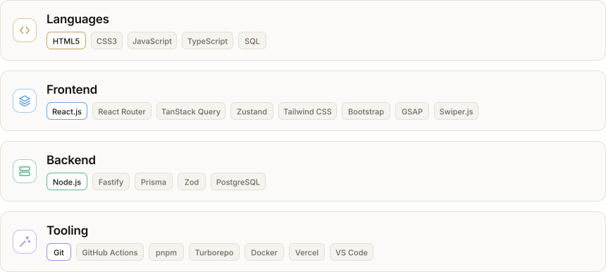

<picture>
  <source media="(prefers-color-scheme: dark)" srcset="./header-dark.svg">
  <source media="(prefers-color-scheme: light)" srcset="./header-light.svg">
  
</picture>

I build web products end to end, from the database schema to the interface.

## Tech Stack and Tools

<picture>
  <source media="(prefers-color-scheme: dark) and (max-width: 620px)" srcset="./stack-narrow-dark.svg">
  <source media="(prefers-color-scheme: light) and (max-width: 620px)" srcset="./stack-narrow-light.svg">
  <source media="(prefers-color-scheme: dark)" srcset="./stack-dark.svg">
  
</picture>

## Contact Me

<a href="mailto:elsayedhamad67@gmail.com"><picture>
  <source media="(prefers-color-scheme: dark)" srcset="./contact-email-dark.svg">
  
</picture></a> <a href="https://www.linkedin.com/in/elsayed-hamad-866340322"><picture>
  <source media="(prefers-color-scheme: dark)" srcset="./contact-linkedin-dark.svg">
  
</picture></a>
